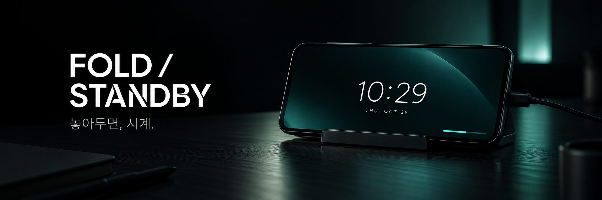
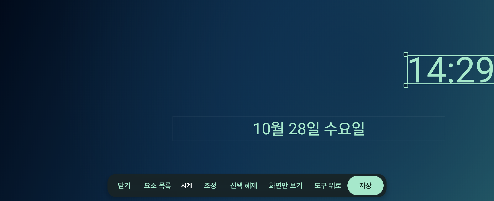
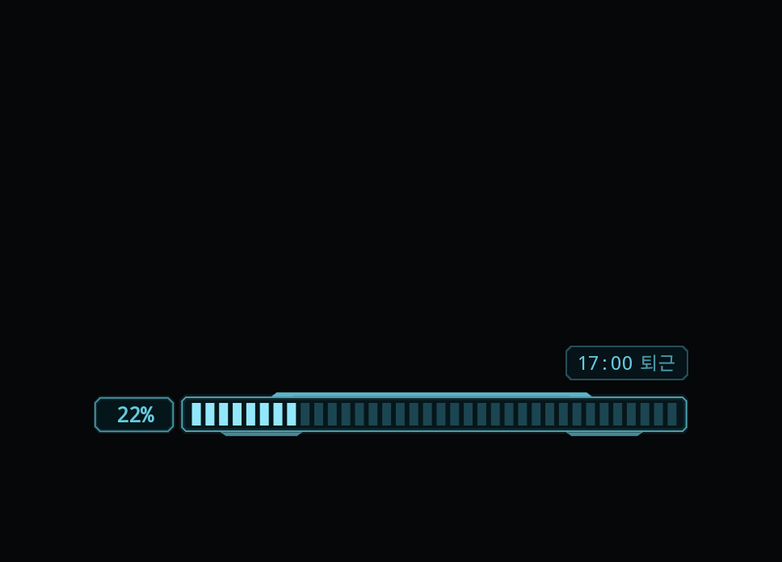
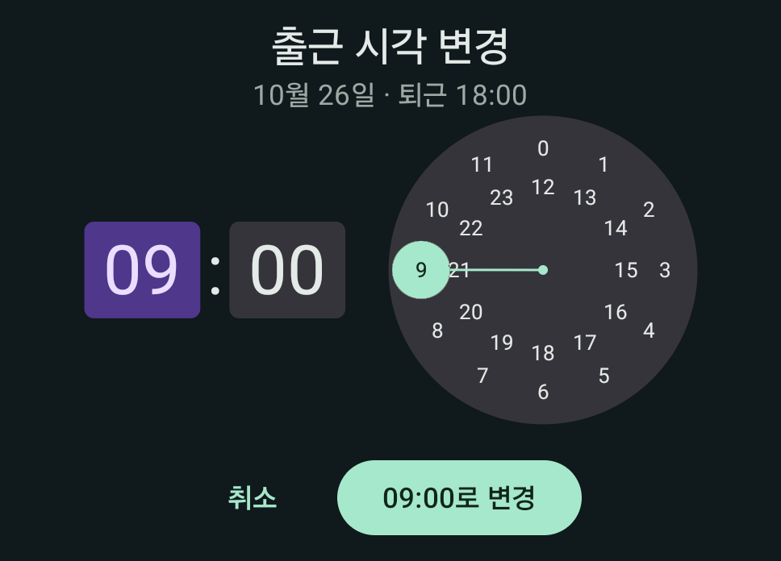
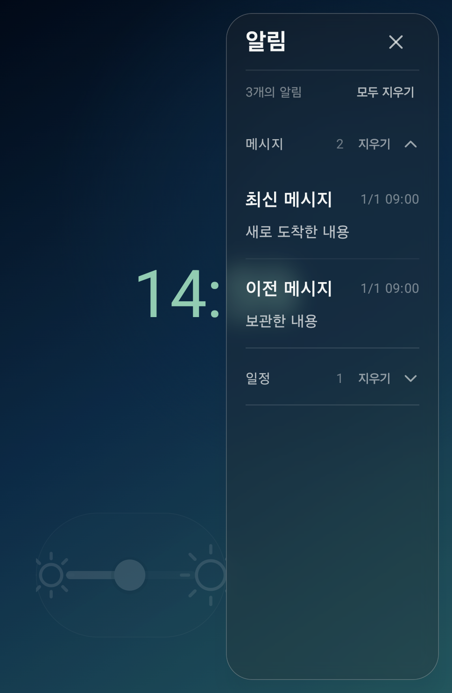

<p align="center">
  
</p>

# Fold 스탠바이

**잠그고, 충전하고, 가로로. 놓아둔 갤럭시를 나만의 시계로.**

Galaxy Z Fold6에서 사용하려고 만든 Kotlin · Jetpack Compose 기반 Android 앱이다. 잠금·충전·가로 자세가 모두 갖춰지면 스탠바이가 열리고, 하나라도 해제되면 닫힌다. 시계와 사진, GIF, 알림, 출퇴근 게이지를 원하는 위치에 배치할 수 있다.

**0.13.0** · Android 12 이상 · Galaxy Z Fold6 중심 개발 · 개인용 실험 프로젝트

[시작하기](#시작하기) · [직접 빌드](#직접-빌드) · [상세 사용 가이드](docs/user-guide.md) · [검증 기록](docs/work-shift-edit-0.13.0.md)

<sub>상단 배너는 소개용 생성 이미지다. 아래 기능 화면은 실제 Fold6 검사 앱에서 촬영했다.</sub>

## 이런 기능이 있다

| 기능 | 할 수 있는 일 |
| --- | --- |
| 조건에 맞춘 자동 실행 | 잠금 + 외부 전원 + 가로 자세를 감지하고, 조건 해제 시 자동 종료 |
| 내 화면 꾸미기 | 시계·날짜·배터리·버튼을 끌어 이동하고, 크기·색상·정렬·내부 여백 조정 |
| 사진과 GIF | 사진 배경, 여러 GIF, 각 GIF의 재생 속도·반복·투명도 설정 |
| 전체 화면 편집 | 실제 가로 화면에서 편집, 겹친 요소 목록 선택, 가장자리 맞춤과 중앙 정렬 가이드 |
| 프리셋과 공통 배치 | 여러 디자인을 저장·순환하고 선택한 요소의 배치를 함께 적용 |
| 알림 패널 | 선택한 앱의 알림 누적, 앱별 펼침·접힘, 내용 공개 범위와 삭제 설정 |
| 출퇴근 게이지 | 출근 시각 선택·길게 눌러 수정, 진행률·예정 퇴근 표시, 완료 폭죽과 자동 퇴근 |
| 밝기와 야간 모드 | 화면 위 유리 스타일 밝기 슬라이더, 수동 적색 야간 모드 |

### 원하는 자리에, 원하는 크기로



선택한 요소를 움직이거나 네 모서리로 크기를 조절한다. 글자 크기와 정렬을 따로 지정하고, 여러 프리셋에서 같은 위치를 쓰도록 공통 배치를 설정할 수 있다.

### 하루의 진행률을 한눈에

<table>
  <tr>
    <td width="50%"></td>
    <td width="50%"></td>
  </tr>
  <tr><td align="center">근무 진행률</td><td align="center">출근 시각 변경</td></tr>
</table>

퇴근 예정 시각은 **출근 시각 + 9시간**과 **출근 당일 17시** 중 더 늦은 시각이다. 100%에 도달하면 폭죽을 표시하고 자동 퇴근하며, 예정 퇴근 시각부터 12시간 동안 게이지만 숨긴다. 시계와 배경은 계속 유지한다.

<details>
<summary><strong>앱별로 모아 보는 알림 패널</strong></summary>

<p align="center"></p>

화면 오른쪽에서 왼쪽으로 쓸어 연다. 앱별로 펼치고 접거나 개별 기록·앱 묶음·표시된 기록 전체를 지울 수 있다. 삭제는 스탠바이 안의 기록에 적용하며 원본 앱의 알림을 지우지 않는다. 위 메시지는 검사 데이터다.

</details>

## 시작하기

1. 아래 방법으로 Debug APK를 빌드하고 설치한다.
2. 앱에서 **자동 실행 권한 설정**을 열어 **다른 앱 위에 표시**를 허용한다.
3. **자동 스탠바이 켜기**를 누르고 감시 알림을 허용한다.
4. 충전기를 연결하고 화면을 잠근 뒤 기기를 가로로 세워 둔다.
5. **화면 꾸미기**에서 디자인을 바꾸고 저장한다. 알림 패널을 사용하려면 알림 접근 권한도 별도로 허용한다.

조건이 약 0.8초 유지되면 시계가 나타난다. 잠금 해제·전원 분리·세로 전환 시 자동으로 닫힌다. 앱 강제 종료·프로세스 종료·재부팅 후에는 앱에서 감시를 다시 켠다. 커버 화면으로 이어 쓰려면 One UI의 **커버 화면에서 앱 계속 사용** 설정도 확인한다.

## 직접 빌드

Android Studio에서 프로젝트를 열고 Android SDK Platform **36.1**과 JDK **17 이상**을 준비한다. 개발·검증에는 JDK 21을 사용했다. SDK 위치는 `ANDROID_HOME` 또는 로컬 `local.properties`의 `sdk.dir`에 지정한다.

```sh
git clone https://github.com/Kuneosu/standby-aos.git
cd standby-aos
./gradlew assembleDebug testValidationUnitTest lintDebug
```

생성된 APK를 연결된 기기에 설치한다.

```sh
adb devices
adb -s <기기-ID> install -r app/build/outputs/apk/debug/app-debug.apk
adb -s <기기-ID> shell am start -n dev.kwonsu.standby/.MainActivity
```

기본 글꼴로 바로 빌드할 수 있다. 선택 글꼴 바이너리는 공개 저장소에 포함하지 않으며, 없으면 기본 글꼴로 표시한다. 별도로 추가할 때는 [외부 자산과 사용 조건](THIRD_PARTY_NOTICES.md)을 확인한다.

## 구조

| 경로 | 역할 |
| --- | --- |
| `app/src/main/java/dev/kwonsu/standby/` | 조건 감지·시계·편집기·프리셋·알림·근무 상태 |
| `app/src/test/` | 조건 정책, 저장 모델, 배치, 근무 시간 계산 등 단위 검사 |
| `app/src/androidTest/` | Compose 상호작용·저장·회귀 검사 |
| `docs/` | 사용 가이드, 기능 조사, 버전별 구현·검증 기록 |
| `scripts/collect-device-evidence.py` | 지정한 기기의 앱 진단 기록 수집 |

`StandbyConditionsObserver`가 상태를 관찰하고 `ChargeMonitorService`가 진입을 제어한다. `StandbyActivity`와 `SceneCanvas`가 화면을 표시하며, `EditorViewModel`·`SettingsStore`가 편집과 저장을 담당한다. 알림 기록과 근무 상태는 각각 별도로 관리한다.

## 검증 범위

[0.13.0 기능 개발 시 검증 기록](docs/work-shift-edit-0.13.0.md)에는 단위 검사 **101개**, Fold6 출퇴근 관련 기기 검사 **19개**, Debug·Validation Lint **오류 0개 / 각 기존 경고 14개**가 기록되어 있다. 설치 버전과 데이터 보존도 별도로 확인했다. 이번 저장소 준비 과정의 빌드 확인은 [공개 준비 검증](docs/github-publication.md)에 구분해서 기록한다.

실기기 자동 검사는 실제 사용 앱과 다른 `dev.kwonsu.standby.validation` 패키지에서 실행한다. 실행 명령과 범위는 [상세 가이드](docs/user-guide.md#빌드와-설치)에 있다. 기기 로그·APK·개인 설정·미디어가 들어가는 `output/`과 빌드 폴더는 저장소에서 제외하며, 검증 문서에서는 해당 파일을 로컬 전용 경로로 표시한다.

## 현재 제약

- Fold6 중심으로 검증했다. 다른 제조사·Android 버전의 자동 실행과 전원 정책은 별도 확인이 필요하다.
- 저전력 AOD가 아니며, 장시간 전력·발열·번인은 측정하지 않았다. 야간 모드는 수동이다.
- 가로 시계를 지원한다. 힌지에 맞춘 자동 재배치는 제공하지 않는다.
- 개인용 Debug 단계다. 스토어 배포·릴리스 서명·자동 업데이트는 포함하지 않았다.
- 네트워크 권한을 요청하지 않는다. 사진·GIF는 사용자가 파일 선택기로 고른 파일만 앱 내부에 복사한다.

## 문서와 자산

- [전체 사용 가이드와 변경 이력](docs/user-guide.md)
- [최초 기능 분석](docs/standby-analysis.md)
- [출근 시각 변경 0.13.0](docs/work-shift-edit-0.13.0.md)
- [전체 화면 편집 0.12.0](docs/editor-canvas-0.12.0.md)
- [외부 자산과 글꼴 사용 조건](THIRD_PARTY_NOTICES.md)
- [README 이미지 출처와 생성 프롬프트](docs/images/README.md)

프로젝트 자체의 오픈소스 라이선스는 아직 지정하지 않았다. 외부 자산과 라이브러리는 각 권리자의 조건을 따른다.
